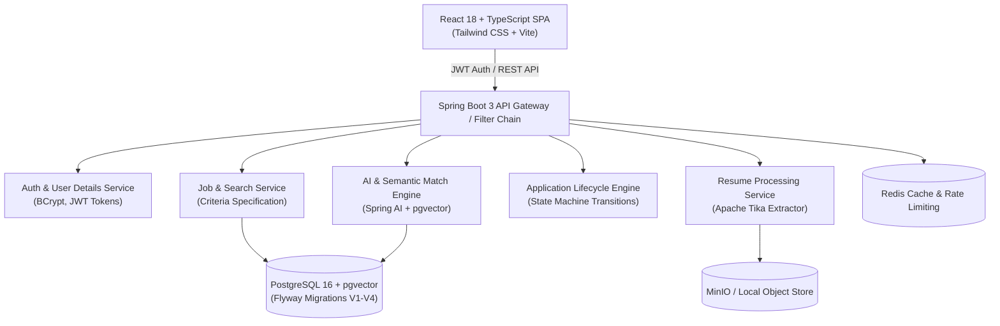

# HireAI — AI-Powered Java Full-Stack Job Portal

[](https://www.oracle.com/java/)
[](https://spring.io/projects/spring-boot)
[](https://github.com/pgvector/pgvector)
[](https://react.dev/)
[](https://www.typescriptlang.org/)
[](https://www.docker.com/)
[](https://opensource.org/licenses/MIT)

> **HireAI** is a production-minded, portfolio-grade AI recruitment platform engineered with **Java 21, Spring Boot 3, PostgreSQL with pgvector, Spring AI, and React 18 TypeScript**. 
> Rather than simple keyword matching, HireAI uses vector embeddings, Apache Tika document text extraction, and an explainable AI fit engine to match candidates and generate tailored interview prep.

---

## 🌟 Key Features

1. **Semantic Job Matching (`pgvector` & Spring AI)**
   - Computes cosine similarity between candidate resume embeddings and target job requisitions.
   - Provides explainable match scoring: overall compatibility, verified overlapping skills, and missing keyword gaps.

2. **Automated Resume Parsing (Apache Tika)**
   - Secure multi-format document ingestion (PDF, DOCX).
   - In-memory text extraction, contact info recognition, and automated indexing.

3. **Tailored Interview Coach**
   - Automatically synthesizes role-specific technical architecture, PostgreSQL concurrency, and behavioral interview questions based on the candidate's background and job requirements.

4. **Production Architecture & Stateless Security**
   - **Spring Security 6** with BCrypt (12 rounds) and stateless JWT authentication.
   - Separate candidate and recruiter portals with strict role-based authorization.
   - Finite state machine for application lifecycles (`APPLIED` ➔ `UNDER_REVIEW` ➔ `SHORTLISTED` ➔ `INTERVIEW_SCHEDULED` ➔ `OFFERED` / `REJECTED`).

5. **Modern Reactive Frontend**
   - React 18, Vite, TypeScript, and Tailwind CSS.
   - Clean dark-mode glassmorphism aesthetics.
   - TanStack Query caching and Axios request interceptors.

---

## 🏗️ System Architecture



---

## 💻 Tech Stack Summary

| Layer | Technologies |
|---|---|
| **Backend Language** | Java 21 (Eclipse Temurin) |
| **Framework** | Spring Boot 3.3.4 (Spring Web, Security, Data JPA, Actuator) |
| **Database & Vector**| PostgreSQL 16, `pgvector` extension, Hibernate 6 |
| **Migrations** | Flyway Database Migrations (`V1` to `V4` SQL schemas) |
| **Document Processing**| Apache Tika 2.9.2, Apache PDFBox 3.0.2 |
| **AI Integration** | Spring AI, configurable OpenAI / Mock provider |
| **Object Storage** | MinIO S3-compatible client with transparent local filesystem fallback |
| **Testing** | JUnit 5, Mockito, AssertJ |
| **Frontend** | React 18, TypeScript, Vite, Tailwind CSS, Lucide Icons, TanStack Query |
| **DevOps & Containers**| Docker, Docker Compose, Multi-stage Dockerfiles, GitHub Actions CI |

---

## 🚀 Quick Start (Docker Compose)

Run the complete multi-container stack (PostgreSQL + pgvector, Redis, MinIO, Backend, Frontend) with a single command:

```bash
docker compose up -d --build
```

### Accessing Endpoints:
- **Web Application**: `http://localhost:5173`
- **Backend REST API**: `http://localhost:8080`
- **Swagger / OpenAPI 3.0 UI**: `http://localhost:8080/api/v1/swagger-ui.html`
- **Actuator Health**: `http://localhost:8080/actuator/health`
- **MinIO Console**: `http://localhost:9001` (user: `minioadmin`, pass: `minioadmin`)

---

## 🛠️ Local Development Setup

### 1. Prerequisites
- JDK 21+
- Node.js 20+ & npm
- PostgreSQL 16 with pgvector (or run `docker compose up -d postgres`)

### 2. Backend Setup
```bash
cd backend
mvn clean spring-boot:run
```

### 3. Frontend Setup
```bash
cd frontend
npm install
npm run dev
```
Open `http://localhost:5173` in your browser.

---

## 🔑 Demo Evaluation Credentials

Use the **1-Click Demo Login** buttons on the login modal or enter:

| Role | Email | Password | Permissions |
|---|---|---|---|
| **Candidate** | `candidate@hireai.dev` | `Password123!` | Upload resumes, search jobs, apply with AI score, track submissions |
| **Recruiter** | `recruiter@hireai.dev` | `Password123!` | Post jobs, manage requisitions, review applicants, transition statuses |

---

## 📋 Database Schema & Flyway Migrations

The database is version-controlled via Flyway:
- `V1__init_extensions_and_users.sql`: Enables `uuid-ossp` and `vector` extensions; initializes users and profiles.
- `V2__jobs_applications_resumes.sql`: Creates `jobs`, `resumes`, and `applications` tables with constraints and indexes.
- `V3__ai_audit_tokens.sql`: Token tables and similarity distance index definitions.
- `V4__seed_data.sql`: Seed tech jobs, company profiles, and skills.

---

## 👨‍💻 SDE Interview System Design Talking Points

When presenting this project in engineering interviews, highlight:
1. **Concurrency & Counter Integrity**: Handling concurrent job view and application count updates atomically using `@Modifying` queries.
2. **Defensive Storage Strategy**: Transparent fallback from MinIO to local filesystem to guarantee zero upload downtime.
3. **Finite State Machine**: Strict business invariant checks in `ApplicationStatus.canTransitionTo()` preventing invalid state transitions (e.g. `REJECTED` ➔ `OFFERED`).
4. **pgvector Scaling**: Comparing Flat vector distance queries against HNSW (`hierarchical navigable small world`) indexing for sub-10ms similarity searches across millions of documents.
5. **Explainable AI vs Blackbox**: Computing exact skill overlap matrices and providing actionable candidate feedback rather than ungrounded LLM scores.

---

## 📜 License
MIT License. Created by [Vishal Yadav](https://github.com/vishalydv3406-rgb).
